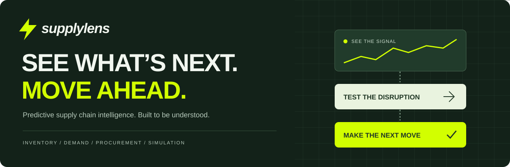
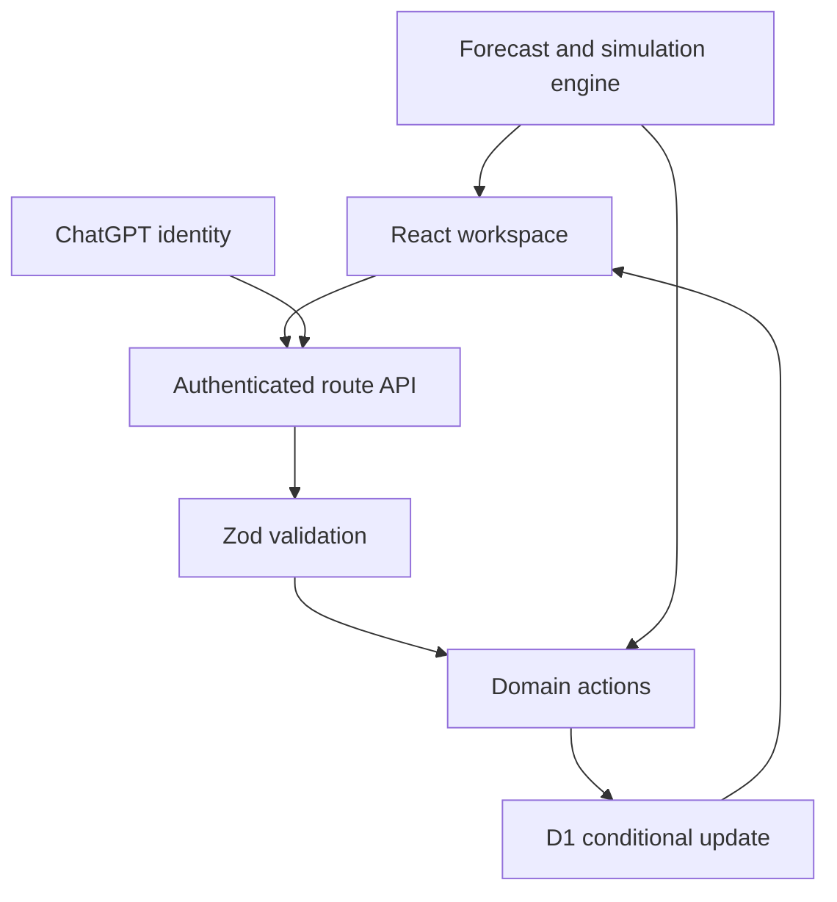

<p align="center">
  
</p>

<p align="center">
  <strong>Know what will run out. Understand why. Decide what to do next.</strong>
</p>

<p align="center">
  <a href="https://supplylens-intelligence.achyuthpvvirat.chatgpt.site"><strong>Explore the live app ↗</strong></a>
  &nbsp; · &nbsp;
  <a href="https://supplylens-intelligence.achyuthpvvirat.chatgpt.site/about">About the project</a>
  &nbsp; · &nbsp;
  <a href="#a-two-minute-product-tour">Product tour</a>
  &nbsp; · &nbsp;
  <a href="#run-it-locally">Get started</a>
  &nbsp; · &nbsp;
  <a href="PROJECT_EXPLAINED.md">Engineering walkthrough</a>
  &nbsp; · &nbsp;
  <a href="https://github.com/Achyuth777/SupplyLens/issues">Report an issue</a>
</p>

<p align="center">
  
  
  
  
</p>

---

## Why SupplyLens

Inventory decisions rarely arrive one at a time. A supplier slips a delivery date, demand rises, and a product that looked well stocked suddenly has six days of cover.

SupplyLens brings inventory, demand history, supplier performance, and purchasing into one workspace. It helps an operations team work through three questions:

- **What needs attention?** Find products below their reorder point or projected lead-time demand.
- **What happens if conditions change?** Simulate delays, demand increases, and reduced supplier capacity.
- **What should we order?** Turn a replenishment recommendation into a purchase order, then receive it into stock.

The calculations are deliberately explainable. You can trace a recommendation back to daily demand, lead time, safety stock, and committed supply.

> **Current release:** a functional, database-backed MVP with synthetic demo data. Workspace access uses ChatGPT sign-in. It is designed for exploration and technical evaluation; team accounts, external integrations, and production operating controls are on the roadmap.

## A two-minute product tour

Open the [live workspace](https://supplylens-intelligence.achyuthpvvirat.chatgpt.site/workspace). Each new account starts with **60 products, 6 suppliers, 3 warehouse labels, and 90 days of sample sales**.

1. **Start with Overview.** Filter the inventory and inspect products that need attention.
2. **Open Shock simulator.** Choose a product, increase demand, and delay its next replenishment. Watch the inventory runway and required stock change.
3. **Go to Reorder engine.** Create a draft purchase order from a recommendation.
4. **Receive the order.** In Purchase orders, place the draft and receive the shipment. Inventory, movement history, and supplier delivery metrics update together.
5. **Try your own assumptions.** Add a product and enter its daily sales history under Demand forecasting.

Your workspace edits persist. The sample dataset is not a live company feed.

## What you can do

| Area | Implemented behavior |
| :--- | :--- |
| **Inventory intelligence** | Create, edit, and archive products; unique SKUs; warehouse, supplier, and category filters; sorting; stock movements |
| **Demand forecasting** | Daily sales entry; 7-, 30-, and 90-day projections; exponential smoothing; one-step backtest MAE |
| **Supplier intelligence** | Supplier profiles, delivery history, on-time performance, observed lead times, and rankings |
| **Supply shock simulator** | Six adjustable inputs, baseline comparison, deterministic shortfall, purchasing requirements, sales exposure, and saved scenarios |
| **Reorder engine** | Lead-time demand and safety-stock calculations, adjusted for draft and ordered incoming units |
| **Purchase orders** | Multiple line items; draft → ordered → received; atomic stock updates; duplicate-receipt protection |
| **Reporting and alerts** | Filtered CSV exports, printable reports, warehouse comparisons, stock alerts, overdue orders, and read status |
| **Workspace** | Persistent profile preferences, per-user data isolation, light/dark themes, and responsive layouts |

## The feature to try first: supply shock simulation

Suppose you have **1,000 units** in stock, sell **50 units per day**, and normally replenish in **7 days**. What happens if the supplier is **15 days late** and demand rises **30%**?

| Result | Calculation | Outcome |
| :--- | :--- | ---: |
| Revised daily demand | `50 × 1.30` | **65 units/day** |
| Replenishment arrival | `7 + 15` | **Day 22** |
| Inventory runway | `1,000 ÷ 65` | **15.38 days** |
| Uncovered demand before arrival | `(65 × 22) − 1,000` | **430 units** |
| Additional usable stock, including 150 safety units | `(65 × 22) + 150 − 1,000` | **580 units** |

These results come from the same functions used by the interface and covered by the test suite. They are scenario calculations, not an invented stockout probability. The runway chart excludes replenishment so the effect of changing assumptions stays visible.

<details>
<summary><strong>How forecasting and replenishment work</strong></summary>

### Demand forecast

The model uses simple exponential smoothing with `α = 0.3`:

```text
next level = 0.3 × observed daily demand + 0.7 × previous level
```

The first observation initializes the model. Future daily predictions use the final level. MAE averages the last 14 available one-step absolute errors. This baseline does not model seasonality or produce calibrated confidence intervals.

### Replenishment

```text
reorder point = ceil(daily forecast × lead time + safety stock)

recommended units = max(0, ceil(
  daily forecast × (lead time + 30 days)
  + safety stock − on-hand stock − committed incoming units
))
```

Draft and ordered purchases count as committed supply to avoid duplicate recommendations. Their arrival timing still needs review. New products need sales history before demand-based recommendations are meaningful.

### Financial exposure

Sales exposure is uncovered units multiplied by selling price. It is neither realized loss nor profit impact. Reduced capacity changes the gross quantity requested to obtain the required usable units; it does not silently change lead time.

</details>

## Architecture



| Layer | Technology | Responsibility |
| :--- | :--- | :--- |
| Interface | React 19, TypeScript, CSS, Lucide | Workspace, forms, themes, and interaction |
| Visualization | Recharts | Demand history, projections, and scenario comparisons |
| Application runtime | Vinext, Vite, Cloudflare Workers | Next-compatible routes and server execution |
| Validation | Zod | Server-side action and payload validation |
| Persistence | Cloudflare D1, Drizzle schema/migrations | Durable user-scoped workspace state |
| Identity | ChatGPT sign-in through Sites | Authenticated access to workspace records |

### One receipt, one consistent update

Receiving a purchase order changes inventory, creates movement records, records the delivery, and changes the order status. These changes commit together through a conditional database update.

Each workspace has a revision number. If two tabs submit against the same revision, only one update succeeds; the other receives a conflict and reloads. Receiving an already-received order is also rejected by the domain rules.

### The storage trade-off

This release stores each user's workspace as a JSON aggregate in a D1 row:

```text
workspaces: owner (primary key), payload, revision
```

That gives the small demo dataset a straightforward atomic write boundary. It is not a normalized inventory database. The next storage milestone is separate product, stock, movement, order, and membership tables with database-enforced relationships. Organization names currently label an individual workspace; they do not establish team membership.

## Run it locally

**Requirements:** Node.js **22.13+** and **pnpm 11.25.0**. Use a local environment supported by Cloudflare Workers tooling; WSL2 is an option on Windows.

```bash
git clone https://github.com/Achyuth777/SupplyLens.git
cd SupplyLens
pnpm install --frozen-lockfile
pnpm build
```

The build generates the local Worker configuration. On a **fresh local database**, apply the initial migration:

```bash
node --import ./scripts/sites-env.mjs ./node_modules/wrangler/bin/wrangler.js d1 execute DB --local --config dist/server/wrangler.json --persist-to .wrangler/state --file drizzle/0000_far_texas_twister.sql
```

Then start development:

```bash
pnpm dev
```

Open `http://localhost:5173`. Clean clones use the portable development profile, whose bundled local sign-in helper creates a loopback-only demo identity. Local D1 state is stored under `.wrangler/state`. The hosted app uses platform authentication instead.

> The full clean-clone setup has not yet been verified end to end. Domain tests, TypeScript checks, and the managed production build have passed. Do not reapply the initial SQL migration to an existing database.

No external AI API key is required. See [`.env.example`](.env.example) for configuration notes.

### Useful commands

| Command | Purpose |
| :--- | :--- |
| `pnpm dev` | Start the local development server |
| `pnpm test` | Run the nine domain/workflow tests |
| `pnpm exec tsc --noEmit` | Check TypeScript |
| `pnpm build` | Build the Worker application |
| `pnpm start` | Run the built Worker locally; does not simulate sign-in |
| `pnpm db:generate` | Generate a migration after a schema change |

## Verification

The test suite covers constant-series forecasting, the worked simulation above, incoming-supply adjustments, purchase receipt effects, invalid stock/SKU rejection, sales-history updates, duplicate reorder protection, supplier performance, and opening-balance consistency.

**Verified:** nine domain/workflow tests; TypeScript check; production build. The latest theme update also passed primary text-color contrast checks.

**Still to verify:** browser workflows, accessibility across assistive technologies, hosted database integration under concurrent load, and full standalone setup. Build success is not treated as evidence of those checks.

## Find your way around

| Path | Start here to understand… |
| :--- | :--- |
| [`app/page.tsx`](app/page.tsx) | The public product experience |
| [`app/workspace/workspace.tsx`](app/workspace/workspace.tsx) | Workspace screens and interactions |
| [`app/api/workspace/route.ts`](app/api/workspace/route.ts) | Authentication, request handling, persistence, and revision checks |
| [`lib/engine.ts`](lib/engine.ts) | Forecasting, reorder math, simulation, alerts, and demo data |
| [`lib/actions.ts`](lib/actions.ts) | Validation and business-state transitions |
| [`db/schema.ts`](db/schema.ts) | The current storage schema |
| [`tests/engine.test.ts`](tests/engine.test.ts) | Executable examples of the domain rules |
| [`PROJECT_EXPLAINED.md`](PROJECT_EXPLAINED.md) | The engineering walkthrough and interview preparation |
| [`docs/TECHNICAL_NOTES.md`](docs/TECHNICAL_NOTES.md) | Detailed methodology and hosting notes |

The root `index.html` and existing deployment files belong to the earlier standalone demo and are retained for continuity. The current full-stack application lives in `app/`.

## Roadmap to a company pilot

- [ ] CSV/Excel imports with validation, column mapping, and duplicate detection
- [ ] Normalized storage, organizations, invitations, and role-based access
- [ ] Dated sales, reserved inventory, stock transfers, returns, and partial receipts
- [ ] Replenishment that considers arrival dates, pack sizes, and supplier minimums
- [ ] Backups with recovery drills, monitoring, and browser/API/database integration tests
- [ ] A read-only pilot using a real company's authorized data

Seasonal forecasting, ERP connections, and subscription billing follow evidence from that pilot. They are not advertised as existing capabilities.

## Deployment and contributions

The live application runs on Sites with a Cloudflare Worker and D1. Its hosting configuration is tracked in [`.openai/hosting.json`](.openai/hosting.json). The repository is not a drop-in Vercel deployment: a migration would require adapting persistence and authentication. GitHub source updates do not automatically update the Sites deployment.

For a bug report, include the affected screen, reproduction steps, expected behavior, and a redacted screenshot where useful. For a change to calculation logic, include a worked example and a test. Read the [contributing notes](CONTRIBUTING.md) before opening a pull request.

## Credits

Built by [Achyuth PV](https://github.com/Achyuth777). The visual direction draws on [Flash — Logistics Branding](https://www.behance.net/gallery/236559247/Flash-Logistics-Branding); SupplyLens uses its own branding and interface illustration. Third-party code retains its accompanying license notices.

No project-wide open-source license has been selected. Repository visibility does not grant a general license to reuse the application; contact the maintainer about permissions.
