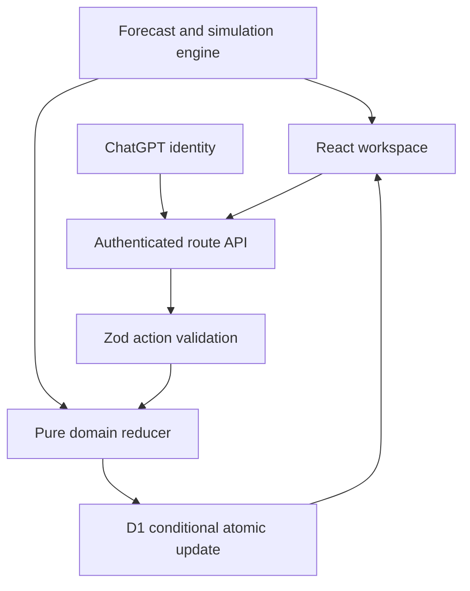

# SupplyLens — Predictive Supply Chain Intelligence

A functional portfolio application for inventory visibility, demand planning, procurement, and disruption simulation. Its acid-lime, near-black, condensed-type visual direction is inspired by the supplied Flash Logistics branding references. SupplyLens has its own brand and original CSS logistics illustration.

## Live application

https://supplylens-intelligence.achyuthpvvirat.chatgpt.site

The landing page is public. The workspace uses platform-managed ChatGPT sign-in and per-user storage.

## What works

- Marketing site with an interactive delay example and links into the application.
- 10 workspace sections, responsive layouts, light/dark themes.
- Database-backed inventory create/edit/archive, unique SKUs, warehouse/category/supplier filters, sorting, pagination, and movement history.
- Historical sales entry and exponential-smoothing demand forecasts for 7/30/90 days with a genuine backtest MAE metric.
- Supplier creation, ranked on-time delivery metrics and delivery history.
- Supply shock simulation: demand increases, supplier/transport delays, inventory and safety stock, reduced fulfillment capacity; saved scenarios.
- Reorder recommendations adjusted for incoming draft/ordered units.
- Multi-line purchase orders: draft → ordered → received. Receipt changes stock, movement history, order state and supplier delivery records in one atomic database update. Duplicate receipts rejected.
- Calculated stock and overdue-order alerts; read-state persistence.
- Inventory CSV exports with formula-injection neutralization; print reports.
- Profile/organization labels, in-app notification preference, sign-out.
- 60 seeded products, six suppliers, three warehouse labels, 90 days of synthetic sales, opening movements and five open orders per new user.

All sample records are clearly demo data. No fabricated AI probabilities, customer claims, or model accuracy percentages.

## Architecture



- **React / TypeScript / Vinext**: Next-compatible file routing, server and client components, Cloudflare Worker deployment.
- **D1 / Drizzle**: durable SQLite storage and tracked schema migration.
- **Zod**: mutation payload validation; client checks are only a convenience.
- **Recharts**: interactive historical and forecast charts.
- **Lucide**: interface icons.
- **CSS**: responsive design system and original logistics illustration.

### Storage schema and deliberate limitation

`workspaces(owner TEXT PRIMARY KEY, payload TEXT NOT NULL, revision INTEGER NOT NULL DEFAULT 0)` stores a bounded portfolio dataset as a serialized aggregate. The payload contains products, suppliers/deliveries, orders/items, movements, scenarios, alert read-state and settings. References use internal IDs. Server domain checks enforce product/supplier relationships and unique SKUs.

This **is not the fully normalized PostgreSQL/Prisma schema in the initial brief**. D1 and an aggregate with optimistic concurrency fit the available hosting. A single conditional update gives atomic receipt semantics without partial writes. It is useful for a small private demo, not an unrestricted multi-user ERP. A production expansion should normalize entities, implement SQL constraints, bounded history retention, organization memberships and indexes, and run true D1 integration/load tests. The UI label “organization” is a display label; access isolation is currently per owner, not team membership.

### Authentication and request protection

The platform establishes authenticated identity. The server rejects missing identity and scopes every read/update to that user. No client-provided owner IDs are trusted. POST checks same-origin and validates the revision. Two simultaneous updates cannot both commit the same revision; the second receives a conflict and the UI reloads current state. No passwords or service secrets are stored by the app.

## Methodology

For historical daily demand x, exponential smoothing uses `level[t] = 0.3*x[t] + 0.7*level[t-1]`, initialized to the first observation. The future forecast is the last level, without trend or seasonality extrapolation. MAE uses the last 14 available one-step errors. New products have zero forecast until history is entered.

- Reorder point = ceil(daily forecast × lead days + safety stock).
- Days cover = on-hand / daily forecast; no demand gives infinity.
- Suggested quantity = max(0, ceil(daily × (lead + 30) + safety − stock − incoming)).
- Simulation daily demand = daily forecast × (1 + demand increase / 100).
- Arrival day = normal lead + supplier delay + transport delay.
- Uncovered units = max(0, ceil(simulated daily × arrival − simulated stock)).
- Additional usable units = max(0, ceil(daily × arrival + safety) − stock).
- Requested units under capacity reduction = ceil(additional usable / (1 − capacity reduction / 100)).
- Sales exposure = uncovered units × selling price. This is exposure, not realized loss or margin.
- Supplier reliability = on-time deliveries / recorded deliveries. No records yields an unranked interpretation in UI, not evidence of poor reliability.

Runway curves intentionally exclude replenishment. Open order timing is not modeled by reorder sizing; a planner must review arrival dates. No probabilistic risk, seasonal model, calibrated uncertainty intervals or EOQ are claimed. Historical turnover is omitted because daily inventory snapshots are absent.

## Local setup

Node 22.13+ and pnpm are required. Install dependencies with `pnpm install`. This project retains the Sites starter build integration. `pnpm dev` starts the framework; managed Linux previews require the supported browser environment, which was unavailable during this build. Configure local D1 and platform authentication according to the starter deployment environment. Never add a development identity bypass to production routes.

`pnpm exec tsc --noEmit` checks types. `pnpm build` creates the Worker bundle. `pnpm db:generate` generates a migration after schema edits. Commit the migration and metadata; do not change already-applied migrations.

To run domain tests using the bundled TypeScript transpiler:

```sh
node scripts/test.mjs
```

Tests cover forecasts, mathematical simulation, reorder sizing, validation, data consistency, purchase receipt effects and duplicate-operation rejection. These are domain/workflow tests, not browser or live hosted database integration tests.

## Deployment

The tracked `.openai/hosting.json` declares the D1 binding. The Sites source workflow builds, syncs source, packages the Worker, then publishes a saved version. Hosting provisions D1 and applies migrations. No extra API keys are required. This deployment is not directly Vercel-compatible: moving it to Vercel requires replacing Cloudflare D1 access and platform identity with a supported database and authentication provider. Do not claim a PostgreSQL/Vercel backend without completing that migration.

## Remaining roadmap

- Normalized database, organizations/memberships and audited roles.
- Dated sale transactions, inventory snapshots, partial receipts and order cancellation.
- CSV import, ERP connectors, sales feeds and email notifications.
- Seasonal model evaluation, uncertainty calibration and stronger backtesting.
- Browser accessibility/responsiveness QA, hosted auth/persistence integration tests and screenshots.

See [`PROJECT_EXPLAINED.md`](../PROJECT_EXPLAINED.md) for interview-oriented explanations. This release does not implement every feature in the broader master brief; the working scope and limitations above are intentional and explicit.
